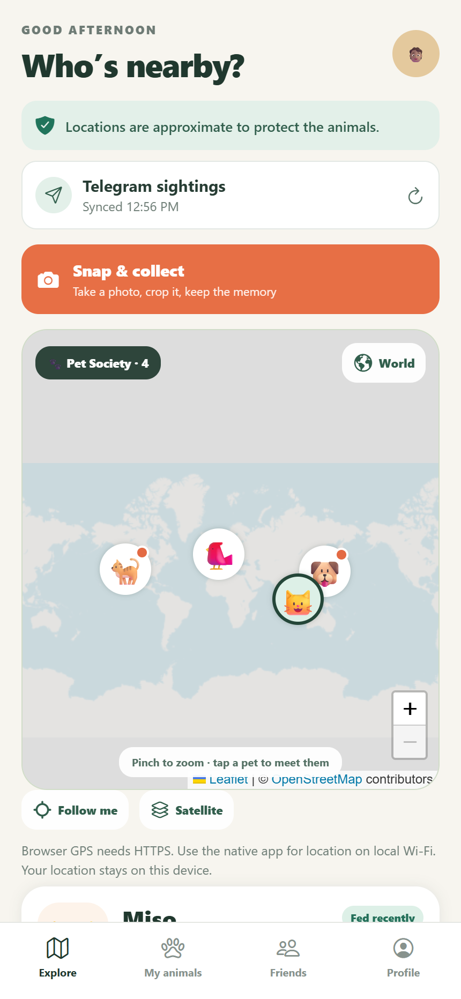
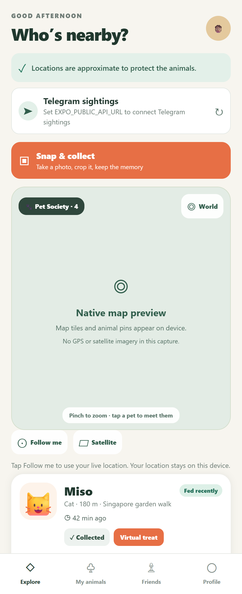
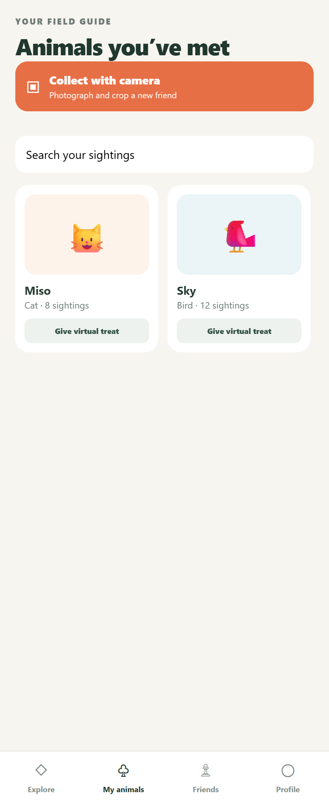
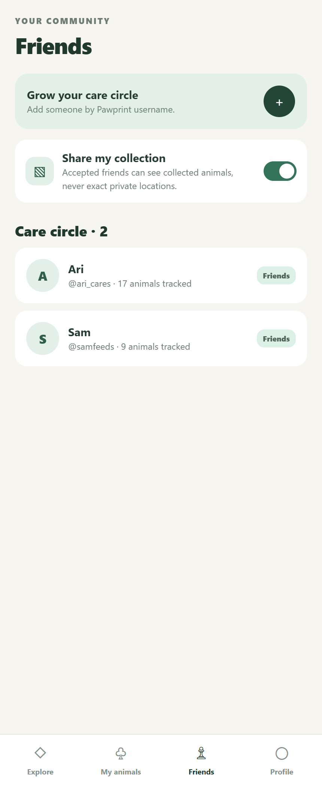
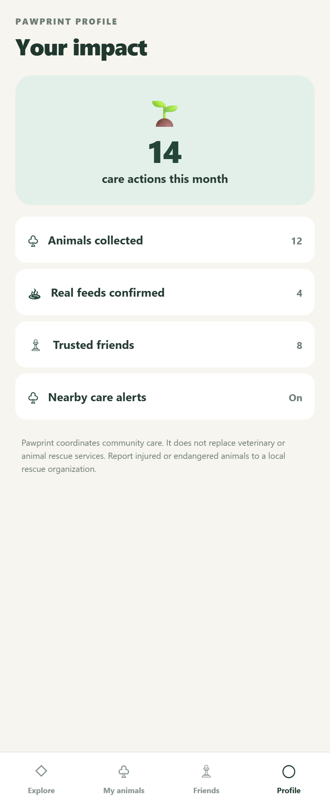
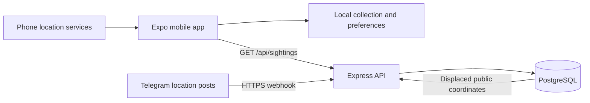

# Pawprint 🐾

A mobile community-care prototype for discovering stray-animal sightings, collecting photo memories, and coordinating care.

**Status:** local prototype · **Stack:** Expo SDK 51 / React Native / TypeScript / Express / PostgreSQL · **Updated:** 11 October 2026

[Preview](#app-preview) · [Features](#features-and-status) · [Setup](#quick-start) · [Docker](#docker-development) · [Telegram](#telegram-sightings) · [Progress](#progress-log) · [Roadmap](#roadmap)

## App preview

Actual browser capture of the running app, using the live local API and real map tiles:



### Component previews

These screenshots render the actual `App.tsx` components through React Native Web at a phone-sized viewport. They are **documentation previews, not native device captures**. The map uses a labeled placeholder, icons use substitute glyphs, and GPS, camera, storage, and backend integrations are stubbed. No real user location is shown.

<table>
  <tr><th>Explore</th><th>My animals</th></tr>
  <tr>
    <td></td>
    <td></td>
  </tr>
  <tr><th>Friends</th><th>Profile</th></tr>
  <tr>
    <td></td>
    <td></td>
  </tr>
</table>

Regenerate with Node.js and Chrome installed:

```powershell
npm ci --prefix scripts/screenshots
npm run capture --prefix scripts/screenshots
```

Set `$env:SCREENSHOT_BROWSER = "msedge"` to capture with Edge instead. This separate documentation tool does not add browser support to the mobile app.

## Features and status

| Feature | Current behavior |
| --- | --- |
| Explore | Native map on phones, Leaflet street/satellite maps in browsers, demo animal pins, and imported sightings when an API is configured. |
| Live location | Foreground GPS, private user marker, accuracy feedback, Follow me, and Stop GPS. Device verification pending. |
| Satellite | Native map provider's hybrid imagery. Device verification pending. |
| Snap & collect | Camera capture, cropping, naming, and locally stored collection records. Camera flow needs device verification. |
| My animals | Collect demo animals and send virtual treats. |
| Friends | Local care-circle records, pending requests, and sharing preference. Server-side invitations and sharing are pending. |
| Real feeding | Confirmation dialog; persistent community care log and notifications are pending. |
| Profile | Illustrative statistics, not live analytics. |
| Telegram | Webhook ingestion and PostgreSQL storage implemented; live bot integration unverified. |
| Government maps | SLA OneMap identified as an option; its tiles are not integrated. |
| Docker | Database, migration, API, and Expo server started and verified locally on 11 October 2026. |

Demo distances, feeding times, and care alerts are illustrative. User movement does not yet recalculate nearby distances or rank sightings.

## Quick start

Requirements: Node.js 20+, npm, and a phone/client compatible with **Expo SDK 51**. A current Expo Go installation may require a newer SDK; use a compatible client or plan an SDK upgrade before device testing.

```powershell
npm ci
npm run typecheck
npm start
```

Open the Expo URL on your phone, on the same Wi-Fi as your computer. Native maps, camera, and GPS run on the phone. For a browser, run `npm run web` and open the HTTP URL printed by Expo. Browser maps use Leaflet, OpenStreetMap street tiles, and Esri satellite tiles.

Without `EXPO_PUBLIC_API_URL`, Explore uses bundled demo animals. To configure the backend:

```powershell
Copy-Item .env.example .env
# Edit .env, then restart Expo.
```

Set the app API URL to an address reachable from your phone, using your computer's LAN address rather than `localhost`. Variables prefixed `EXPO_PUBLIC_` are bundled into the app; keep secret credentials out of them.

## Docker development

Start Docker Desktop using Linux containers, then run PostgreSQL, apply the schema, and start the API:

```powershell
docker compose up --build -d
Invoke-RestMethod http://localhost:3000/health
Invoke-RestMethod http://localhost:3000/api/sightings
```

Sightings are empty until data is ingested. PostgreSQL stays within the Compose network; the `postgres_data` volume preserves database data.

To also run Expo, find your Wi-Fi/Ethernet IPv4 address with `ipconfig` and replace this example:

```powershell
$env:DEV_HOST_IP = "192.168.1.20"
docker compose --profile mobile up --build
```

For a phone browser, open **`http://192.168.1.20:8081`**. For Expo Go, open **`exp://192.168.1.20:8081`** in a compatible client. Keep both devices on the same Wi-Fi and allow TCP ports 8081 and 3000 through Windows Firewall on your private network. Docker runs the development server; the phone runs the UI. `App.tsx` and `components/` are mounted for edits while Expo runs.

If the phone says the webpage cannot be found, use the complete `http://` address in its browser, check that `DEV_HOST_IP` matches the computer's current Wi-Fi address, and check the firewall/router allows connections between the devices. An `exp://` address is for an Expo client rather than a browser. Browser GPS requires HTTPS; on local HTTP the app displays a message explaining this requirement. Native foreground GPS remains available through the Expo client.

```powershell
docker compose ps
docker compose logs api
docker compose --profile mobile down
```

Stopping containers preserves the database volume. This configuration uses a local development password. If your device requires HTTPS API traffic, configure an HTTPS endpoint and override the mobile service's `EXPO_PUBLIC_API_URL` in `compose.yaml`.

## Live map and privacy

1. Open Explore and tap **Follow me**; allow foreground location access.
2. Walk to receive updated device coordinates and camera recentering.
3. Drag the map or tap **World** to pause camera following. GPS remains active on Explore.
4. Tap **Follow me** to resume, or **Stop GPS** to end updates and clear the marker.

The app requests high accuracy, a 5 m movement threshold, and a 3 second interval on Android. Delivery timing and accuracy depend on the device. Updates stop when leaving Explore or backgrounding the app and resume on return when location remains enabled.

User coordinates stay in device memory; the app does not save them to storage or send them to the sightings server. Permission denial or unavailable location services produce a retry message.

Satellite imagery supplies the background; phone location services supply live movement. Singapore government basemaps are available from [SLA OneMap](https://www.onemap.gov.sg/docs/maps/index.html), but this build uses the native map provider. MCP can expose data to an AI assistant; no MCP server was added to this project.

Public Telegram animal coordinates are deterministically displaced by roughly 150–350 m. Exact source coordinates remain in the backend database. Virtual treats never update a physical feeding timestamp.

## Architecture



| File | Purpose |
| --- | --- |
| `App.tsx` | Screens, native map, GPS, camera collection, and sightings fetch. |
| `app.json` | Expo identity, permission descriptions, and native plugins. |
| `server/index.js` | API, Telegram parsing, and location displacement. |
| `server/schema.sql`, `server/migrate.js` | Database tables and migration. |
| `Dockerfile`, `compose.yaml` | Development containers and startup order. |
| `.env.example` | Environment configuration template. |
| `eas.json` | Development, preview, and production build profiles. |
| `scripts/screenshots/` | Reproducible documentation previews. |

## Telegram sightings

The webhook accepts `channel_post` and `edited_channel_post` updates containing a location or venue. It stores the Telegram timestamp, species, optional name, caption, channel, and coordinates. The app fetches public sightings from `GET /api/sightings`.

1. Create a bot through `@BotFather` and add it as an administrator in participating channels.
2. Configure the database and `TELEGRAM_WEBHOOK_SECRET`. Keep the bot token private; use it to register the webhook.
3. Outside Docker, run `npm run db:migrate`, then `npm run server`.
4. Expose the API through a public HTTPS URL and register it with Telegram. A local Docker address is not reachable by Telegram.

After setting the environment variables, register from PowerShell:

```powershell
$body = @{
  url = "$env:PUBLIC_BASE_URL/telegram/webhook"
  secret_token = $env:TELEGRAM_WEBHOOK_SECRET
  allowed_updates = @("channel_post", "edited_channel_post")
} | ConvertTo-Json

Invoke-RestMethod -Method Post `
  -Uri "https://api.telegram.org/bot$env:TELEGRAM_BOT_TOKEN/setWebhook" `
  -ContentType "application/json" -Body $body
```

Share a location pin with a caption such as `Cat name: Miso` or `Dog #Pepper`. Plain text does not supply a device location. Set `EXPO_PUBLIC_API_URL` to your public API URL and restart Expo to import sightings alongside demo animals.

| Setting | Purpose |
| --- | --- |
| `DATABASE_URL` | PostgreSQL connection; Compose supplies its own local value. |
| `PORT` | API port; defaults to 3000. |
| `TELEGRAM_WEBHOOK_SECRET` | Validates Telegram's secret header; webhook calls are rejected when unset. |
| `TELEGRAM_BOT_TOKEN` | Webhook registration; not needed by the ingestion handler. |
| `PUBLIC_BASE_URL` | Public HTTPS API URL for registration. |
| `EXPO_PUBLIC_API_URL` | Phone-reachable API URL bundled into the app. |
| `DEV_HOST_IP` | Docker Expo server's advertised LAN address. |
| `WEB_ORIGIN` | Exact browser origin allowed to read the API; Compose sets it from `DEV_HOST_IP` and port 8081. |

## Verification

```powershell
npm run typecheck
docker compose config --quiet
```

Both checks passed on 10 October 2026. Container builds, migration, and API runtime checks could not run because the Docker engine was unavailable then. Browser preview screenshots do not validate native integrations.

On 11 October 2026, Docker Desktop was started and the full Compose stack built and ran successfully. PostgreSQL reported healthy, migration exited with code 0, `/health` returned `{"ok":true}`, and `/api/sightings` returned `{"sightings":[]}` through the computer's LAN address. Both iOS and Android Expo bundles compiled and returned HTTP 200. The mobile container uses the LAN API URL. These checks verify server startup and bundle compilation; native rendering and phone connectivity remain unverified.

The browser entry point was subsequently verified with a phone-sized Chrome viewport: the real API response, four demo markers, street and satellite tiles, HTTPS GPS message, and all four tabs passed without page errors. The iOS bundle was recompiled successfully after introducing the platform-specific maps. To rerun the browser checks, set `APP_URL` to your running app's HTTP address, then run `node scripts/screenshots/check-web.cjs`.

Physical-device checks still needed:

- Allow and deny location access; verify retry and error messages.
- Walk with Follow me active; drag, recenter, and stop GPS.
- Leave Explore, background the app, and return; check subscription behavior.
- Switch street/satellite views and verify native map rendering.
- Photograph, crop, name, and reopen a collectible.
- Import a real Telegram location post and verify displaced public coordinates.

## Progress log

### 11 October 2026

- Added a real browser entry point and Leaflet map, browser name prompts, and configured API CORS for the development webpage.
- Pinned the SDK-compatible Expo font dependency to fix a browser startup crash; added a browser verification script at `scripts/screenshots/check-web.cjs`.
- Verified the real browser UI, API fetch, map tiles, markers, tabs, and HTTPS location message; captured the running webpage for this README.
- Started Docker Desktop and the complete Compose stack; verified schema tables, API responses, and iOS/Android bundle compilation.
- Reorganized README with screenshots, feature status, setup, architecture, configuration, verification, and roadmap.
- Added four UI preview screenshots and a reproducible capture script.
- Clarified demo statistics, local-only friend behavior, native testing limits, and pending integrations.

### 10 October 2026

- Added foreground GPS, Follow me, private user marker, accuracy feedback, Stop GPS, and satellite controls.
- Added location cleanup on leaving Explore/backgrounding and camera-follow pause on dragging/World.
- Added Docker services for PostgreSQL, migration, API, and optional Expo server.
- Added Docker build exclusions and Git exclusions for local environment files.
- Reviewed OneMap and explained MCP; neither integration was installed.
- Passed TypeScript and Compose configuration checks; device and container runtime verification remained pending.

## Roadmap

- [x] Prototype Explore, My animals, Friends, and Profile.
- [x] Implement foreground GPS and satellite controls.
- [x] Implement Telegram ingestion and public sightings API.
- [x] Add Docker setup and documentation previews.
- [ ] Verify native flows on a compatible physical device.
- [x] Verify Docker builds, migration, and API responses.
- [ ] Configure and verify a live Telegram webhook.
- [ ] Replace demo distances, alerts, feeding times, and statistics with real data.
- [ ] Add authentication, server-backed friend permissions, and collection sharing.
- [ ] Add persistent care logs, duplicate-feeding safeguards, and notifications.
- [ ] Add moderation, abuse reporting, stale-sighting expiry, and sensitive-location access controls.
- [ ] Evaluate an Expo SDK upgrade and optional OneMap integration.
- [ ] Complete iOS release preparation.

## iOS release preparation

An Expo account and Apple Developer account are required. Device testing and production backend work remain prerequisites.

```powershell
npx eas-cli login
npx eas-cli init
npx eas-cli build --platform ios --profile production
npx eas-cli submit --platform ios
```

`eas init` replaces the placeholder project ID in `app.json`. The account owner completes Apple credentials, App Store privacy details, native screenshots, support URLs, and review submission. EAS cloud builds do not require a local Mac.

Pawprint coordinates community care and does not replace veterinary or rescue services. Report injured or endangered animals to a local rescue organization.
